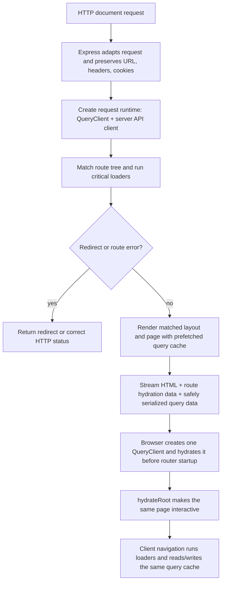

# Campus & Clubs Web Frontend Architecture

This is the target architecture for `clients/web`. It describes how new work should be built and how the existing app can move there without a rewrite.

## Architecture decisions

1. **Keep the current custom SSR stack.** The app already uses React Router Data Mode with `createBrowserRouter`, `createStaticHandler`, Express, Vite, and React streaming. Add loaders and request-scoped data to that stack before considering React Router Framework Mode. React Router explicitly supports Data Mode with a custom bundler and server. [React Router modes](https://reactrouter.com/start/modes), [custom server rendering](https://reactrouter.com/start/data/custom)
2. **Load critical route data before rendering the page.** Matched route loaders await critical queries. React Router runs matched loaders before rendering the route component; route modules can also be loaded lazily. [Data loading](https://reactrouter.com/start/data/data-loading), [route objects and lazy routes](https://reactrouter.com/start/data/route-object)
3. **TanStack Query is the client cache for remote/server state.** A loader primes that cache; the page reads from the same query options. Keep form drafts and transient UI state in React state or a feature-scoped context.
4. **A server request gets a new QueryClient and authenticated API client.** The browser gets one stable QueryClient for the current app session. Never share a server QueryClient or a cookie-bearing API client between requests.
5. **One feature owns each API operation.** Pages compose UI, query definitions own read keys, mutation hooks own writes and cache updates, and HTTP clients own transport and version details.
6. **Route metadata has one source.** Routes declare metadata; the same matched route metadata renders in SSR and after client navigation.

## What the app does today

The current app is a useful base, but its SSR and client data paths are not connected yet:

| Area | Current flow | Architecture concern |
|---|---|---|
| SSR | `server.ts` filters HTML requests, calls a pathname-based `getPageMeta`, then `app.server.tsx` runs `createStaticHandler` and streams the tree. | There are no route loaders in the feature route arrays, so critical API data is not awaited before render. Most `useQuery` calls render loading UI on the server and fetch after hydration. |
| Request | The Express handler constructs a new `Request` from `http://localhost:3000` and the URL. | It drops the original method and request headers, including cookies. Server loaders cannot safely identify the visitor yet. |
| Query cache | `query-client.ts` creates a module-level `queryClient`; both server and browser entry points import it. | Concurrent SSR requests can share cache state. The browser also has a `getClientQueryClient()` factory, but the entry point does not use it. |
| Hydration | `config/dehydration.tsx` has serialize/extract helpers and the client imports hydration utilities. | The query state is not currently dehydrated on the server and hydrated before the browser router starts. |
| Routing | `routes.tsx` composes nested route arrays from feature `router.tsx` files. Pages/layouts use nested outlets. | The tree is a good foundation for Data Mode, but feature route definitions do not yet use loaders/actions or route-level metadata. |
| Metadata | `getPageMeta()` has a small pathname switch. `MetaUpdater` exists but is not mounted in `app.client.tsx`; it looks for metadata outside the route `handle` pattern. | Server and client metadata can diverge, and dynamic page metadata is not derived from loaded page data. |
| HTTP | `settings/api/v1` contains singleton authenticated/public clients. `BaseClient` always uses v1; v2 is a placeholder. The v1 request interceptor reads `document.cookie`. | The current clients are browser-oriented and cannot be reused for authenticated SSR. Version choice is not isolated behind a feature API boundary. |
| Auth | `Guard` skips auth checks on the server and on the first hydration render, then checks session in the browser. | This avoids a hydration mismatch, but it cannot protect SSR loader data. Backend authorization remains required for every protected API operation. |

The key security correction is to remove module-scoped request state on the server. TanStack Query's SSR guidance specifically calls for a per-request QueryClient so one visitor's cache cannot be returned to another. [TanStack Query SSR](https://tanstack.com/query/latest/docs/framework/react/guides/ssr)

## Target request and render lifecycle



### Server document request

1. Express converts the incoming request into a Web `Request`, preserving the public URL, method, headers, cookie header, and abort signal. Trust forwarded host/protocol headers only when the proxy is configured as trusted.
2. Create a request runtime containing a fresh `QueryClient` and an API client bound to this request's credentials. Do not import a browser singleton from a loader or server module.
3. Create the route tree with that runtime and call `createStaticHandler(routes).query(request)`. Loaders for the matched branch run before `StaticRouterProvider` renders. Return a redirect response immediately; otherwise retain loader errors and status codes for the response.
4. Each critical loader awaits the feature's shared query options. A page then reads the hydrated query with `useSuspenseQuery` or `useQuery`; it does not repeat the endpoint call in an effect.
5. Render with `AppProviders` using the request QueryClient and the static router. Serialize the successful query cache into the HTML using an XSS-safe serializer. The existing dehydration helper escapes `<`, but it needs to be wired into this response path.
6. Set `Cache-Control: private, no-store` for personalized HTML and data unless a deliberate user-aware cache policy exists. Never serialize credentials, CSRF secrets, or server-only response fields into the query cache.
7. Clear the request QueryClient only after rendering and streaming have completed. Avoid `gcTime: 0`; TanStack warns that it can race hydration. [TanStack SSR and hydration](https://tanstack.com/query/latest/docs/framework/react/guides/ssr)

### Browser boot and client navigation

1. Create the browser QueryClient once for the hydrated application, not once per page or component.
2. Parse and hydrate the serialized TanStack state **before** creating the browser router if initial route loaders use that client. Initialize React Router with its own static hydration data as well.
3. Call `hydrateRoot` with the same provider/layout tree that produced the server markup. Keep initial server and client rendering deterministic; browser-only APIs belong in effects or browser-only API implementations.
4. On navigation, React Router loaders run for the next route before that route renders. They call `ensureQueryData` or `fetchQuery` using the same query options as the component. Use router pending UI for slow transitions.

TanStack's SSR flow is: prefetch before rendering, dehydrate the server cache, then hydrate a separate browser cache. The server and browser intentionally use different QueryClient instances with the same serialized initial data. [TanStack Query SSR](https://tanstack.com/query/latest/docs/framework/react/guides/ssr), [hydrate reference](https://tanstack.com/query/latest/docs/framework/react/reference/functions/hydrate)

## QueryClient ownership and user isolation

| Runtime | Lifetime | Owns | Rules |
|---|---|---|---|
| SSR document request | One HTTP request | That request's prefetched remote data and server API client | Create inside the request handler. Forward only the credentials needed for that request. Never store it in module state. |
| Browser app | One app/tab session | Remote data visible to the current signed-in user | Create lazily once. Use `useQueryClient()` in components and hooks instead of importing a module singleton. Clear private cache on logout or account switch. |
| Route/page | No QueryClient of its own | Route-specific prefetch decisions | Reuse the runtime QueryClient. Do not create clients in page components. |
| Mutation | Uses the browser app's QueryClient | Cache updates and invalidation after a write | Use `useMutation`; on success update or invalidate the feature's query-key family. The API remains the source of truth. |

The browser cache must not leak across account changes. Include the user/tenant identity in private query keys when the same key could refer to different users, and clear private queries on logout/account switch. Never put access tokens in query keys or dehydrated data.

## Routes, layouts, and pages

Keep `src/routes.tsx` as the route-tree composer and the feature route files as owners of their branches. Use stable route IDs, nested layouts, and `Outlet` for shared shells. Keep `settings/routes` path constants/builders while they are in use; avoid retyping route strings in pages.

```text
src/
  app/
    client.tsx                 # browser QueryClient, router, hydrateRoot
    server.tsx                 # request-scoped render pipeline
    routes.tsx                 # compose feature route trees
    providers/                 # app-wide providers only
  server/
    request-runtime.ts         # request QueryClient + server API client
    web-request.ts             # Express -> Web Request adapter
    render-document.ts         # status, headers, streaming, query serialization
  config/
    query-client.ts            # createQueryClient + getBrowserQueryClient
  settings/
    api/
      transport/               # shared request/error primitives
      versions/v1/             # v1 browser/server client factories and contracts
      versions/v2/             # v2 browser/server client factories and contracts
    routes/                    # path constants and builders
  features/
    club/
      router.tsx               # feature route branch
      pages/                   # route-level page composition
      layouts/                 # feature shell and nested outlets
      components/              # reusable feature UI and action buttons
      api/                     # feature endpoint adapters and query options
      model/                   # query keys, domain types, schemas
      context/                 # short-lived state shared by a feature branch
    user/
    posts/
    auth/
  layouts/                     # app-wide shells
  shared/
    components/                # app-wide reusable UI
    hooks/
    lib/
  meta/                         # shared route metadata renderer/types
```

This is a destination, not a rename checklist. Continue using the existing `features/club/http`, `services`, and `hooks` folders while migrating one feature. Add the new query/mutation modules beside them, then move old callers gradually.

### Route responsibilities

- **App layout:** global shell, global error boundary, app-wide providers, one metadata renderer. It should not own feature query data.
- **Feature layout:** shared feature shell and feature-level data loading when all child routes need the same entity. Use a typed outlet context only for ephemeral branch state or an already-loaded layout object.
- **Page:** compose page sections and query hooks. Avoid fetching in `useEffect`; avoid copying query data into local state unless it is an editable draft.
- **Feature components:** reusable visuals and actions. An action component calls a feature mutation hook and displays pending/error/success states; it does not build endpoint URLs or own cache keys.
- **Route loader:** authorize/load the route-critical data and prime TanStack Query before render. A parent loader is not an authorization boundary for its child loaders; each protected data path and the backend must authorize independently. [React Router loader guidance](https://reactrouter.com/start/framework/data-loading)
- **Route action:** use React Router `action`/`fetcher` when route-form semantics or progressive enhancement are needed. For the existing API-backed app, use TanStack mutations by default. Do not perform one write through a router action and again through a mutation. If an action is selected, it calls the same feature service and the cache/revalidation policy is explicit. [React Router actions](https://reactrouter.com/start/data/actions)

### Data ownership rules

| Data | Owner |
|---|---|
| API records, feeds, session, permissions, paginated results | TanStack Query cache |
| Shareable filters, sort, pagination, selected resource | URL/search params |
| Form edits, open dialog, unsaved draft, temporary tab when not shareable | Component state or feature-scoped context |
| Route redirect/status and one-off route decision | Loader/action result |
| Persistent authoritative business data | Backend |

Do not mirror a query result into context just to make it globally available. Query cache is already the shared client-side store for remote state.

## Query options, keys, reads, and writes

Put a query key and query function together. Every variable used by the request belongs in the key: resource ID, filters, pagination, locale/tenant, and any response-version dimension. Keep key builders in the feature, for example:

```ts
export const clubKeys = {
  all: (apiVersion: string) => [apiVersion, "clubs"] as const,
  detail: (apiVersion: string, slug: string) =>
    [...clubKeys.all(apiVersion), "detail", slug] as const,
};

export const clubQueries = {
  detail: (api: ClubApi, slug: string) =>
    queryOptions({
      queryKey: clubKeys.detail(api.version, slug),
      queryFn: ({ signal }) => api.getClub(slug, { signal }),
    }),
};
```

The `api` above is a version-selected feature adapter, not a raw Axios singleton. A loader and component share the same options:

```ts
// Route loader: waits for the data needed for the first page render.
await runtime.queryClient.ensureQueryData(
  clubQueries.detail(runtime.api.club, params.slug),
);

// Page: reads the already-populated cache and stays subscribed to updates.
const { data: club } = useSuspenseQuery(
  clubQueries.detail(browserApi.club, slug),
);
```

Use `fetchQuery` when the loader needs a fresh result and wants errors to reach the route boundary. Use `ensureQueryData` when a fresh cached result is acceptable. Reserve `prefetchQuery` for optional work that may not block the page. Keep a positive `staleTime` for SSR-prefetched data to prevent an immediate duplicate browser request; tune it by data volatility rather than copying a universal number.

Writes belong to feature mutation hooks. They call the feature service, then use `useQueryClient()` to update the exact detail cache or invalidate affected list/detail keys. For example, an edit to a club role should invalidate that role and the club's roles list. Keep optimistic updates only where rollback and concurrency behavior are defined.

## HTTP client versioning

Keep API version selection below feature pages and query hooks:

1. **Transport layer:** base URL, credentials, CSRF, timeout/abort signal, error normalization, tracing. It has browser and server implementations because browser globals and request cookies do not exist in the same form on the server.
2. **Version clients:** `versions/v1` and `versions/v2` know each version's base path, auth scheme, generated contracts, and wire envelope.
3. **Feature adapter:** `features/<feature>/api` maps version-specific responses into the feature's stable view/domain model. The rest of the app calls this adapter.
4. **Query/mutation layer:** consumes the adapter and owns keys/cache policies. Pages do not import `api.v1` or concatenate endpoint strings.

When v2 has the same meaning and shape after adaptation, keep one canonical feature query key. Add an API-version segment to a query key only if both representations can coexist in the same browser cache with different semantics or incompatible data. Keep generated v1/v2 types separate from domain types.

Do not use the current singleton `V1Client` from SSR. Its interceptor reads `document.cookie`; a server-side client must be created from the current request and must not retain cookies or refresh state between visitors. The browser can keep a stable credentialed client for the active session.

## Metadata, status codes, and errors

Replace the separate pathname metadata switch and effect-based client updater with a route metadata contract:

```ts
type PageMeta = {
  title: string;
  description?: string;
  robots?: "index,follow" | "noindex,nofollow";
};

type AppRouteHandle = {
  meta?: (match: { params: Record<string, string | undefined>; loaderData: unknown }) => PageMeta;
};
```

Routes declare a `handle.meta`; one `RouteMetadata` component in the root app reads `useMatches()`, selects the deepest match with metadata, and emits one `<title>` plus the applicable `<meta>` elements. React 19 hoists these tags into `<head>` during SSR and client rendering, avoiding hand-built HTML strings. `useMatches` exposes route `handle` and loader data for this pattern. [React `<title>`](https://react.dev/reference/react-dom/components/title), [React `<meta>`](https://react.dev/reference/react-dom/components/meta), [React Router `useMatches`](https://reactrouter.com/api/hooks/useMatches)

Dynamic titles should use loader data, such as the loaded club name. Private settings, account, and chat pages should use `noindex`. Escape no data manually into an HTML template; render React metadata elements. Keep canonical URLs based on a configured public origin, not an untrusted Host header.

Set the HTTP response status from the matched router context. A not-found loader should produce 404; permission failures should not be converted to a 200 shell. Render route error boundaries with an appropriate page-level fallback and avoid leaking backend stack traces or sensitive response fields.

## Providers and contexts

- Keep app-wide providers in `AppProviders`: QueryClient, theme, tooltip, toast, and truly app-wide UI services.
- Keep route data in the query cache or loader result, not in a global React context.
- Keep layout contexts narrow and typed. Use an outlet context for values owned by a layout branch; use a feature provider only when many descendants need local state not represented by URL/query data.
- Do not put per-request API clients or server QueryClients in a browser provider singleton.
- Avoid putting write behavior in a context. A mutation hook should own the operation and its cache effects.

## Security and cache policy

- Treat the backend as the authorization authority. A hidden page or guarded route is not authorization.
- Each protected loader/action and API endpoint checks the current user/permission. React Router can run matched loaders in parallel, so a parent loader alone cannot guard every child data request. [React Router auth/data loading notes](https://reactrouter.com/start/framework/data-loading)
- Keep access/refresh tokens and raw cookie headers outside dehydrated query data, route loader data, URLs, and logs.
- Do not put personalized HTML or dehydrated private query data in a public shared cache.
- Forward only the required request credentials to backend APIs. Do not reuse a mutable axios refresh queue between server requests.

## Official references

- [React Router mode selection](https://reactrouter.com/start/modes)
- [React Router custom server and SSR](https://reactrouter.com/start/data/custom)
- [React Router data loading](https://reactrouter.com/start/data/data-loading)
- [React Router actions](https://reactrouter.com/start/data/actions)
- [React Router handles and `useMatches`](https://reactrouter.com/how-to/using-handle)
- [TanStack Query SSR and hydration](https://tanstack.com/query/latest/docs/framework/react/guides/ssr)
- [TanStack `dehydrate`](https://tanstack.com/query/latest/docs/framework/react/reference/functions/dehydrate)
- [React 19 document metadata](https://react.dev/reference/react-dom/components/title)
